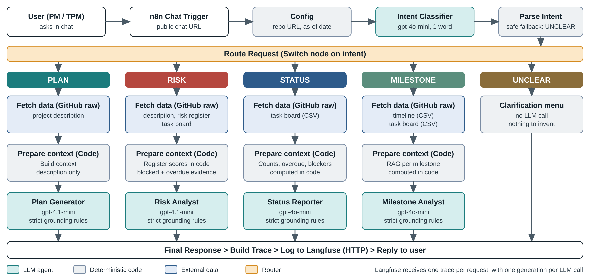

# Mira - AI Project Management Assistant

Capstone project for **Applied Agentic AI for PMs/TPMs**. Mira is a multi-agent assistant built in **n8n** that helps a PM/TPM with four jobs: create a **project plan**, assess **risks**, write a **weekly status report**, and check **milestone health**.

**Pattern:** Router / Dispatcher. A classifier agent reads the request and sends it to one of four specialist agents. Unclear requests get a clarification menu instead of a guess.

**Key design idea:** numbers are computed by code, not by the LLM. Task counts, overdue days and milestone RAG status come from Code nodes. The LLM only writes the narrative, so it cannot miscount or invent a status.

## Repository layout

| Path | What it holds |
|---|---|
| `workflow/mira_n8n_workflow.json` | The n8n workflow. Import this file into n8n. |
| `prompts/` | The five agent system prompts (same text as inside the workflow). |
| `data/` | Sample ABCDE Ltd. data: project description, timeline, task board, risk register. |
| `tests/` | 12-case baseline test dataset, results template, and results after you run them. |
| `scripts/run_baseline_tests.py` | Runs all 12 tests against your n8n chat URL and writes `tests/test_results.md`. |
| `docs/Setup_Guide.md` | Step-by-step import and connector setup. |
| `docs/Project_Plan.md` | Delivery plan, deliverables and risks for this capstone. |
| `docs/Architecture_Writeup.md` | The 1-2 page writeup: design, tools, cost, metrics, testing. |
| `docs/Evaluation_Log.md` | Template to record the evaluate - fix - re-evaluate loop. |
| `diagrams/` | Architecture diagram (SVG and PNG). |
| `presentation/` | Project presentation (PowerPoint). |

## Quick start

1. Push this folder to a **public** GitHub repository named `mira-capstone`.
2. In n8n, import `workflow/mira_n8n_workflow.json`.
3. Open the **Config** node and set `baseUrl` to `https://raw.githubusercontent.com/<your-username>/mira-capstone/main`.
4. Select your OpenAI credential on the five **OpenAI Model** nodes.
5. (Optional) Add a Langfuse credential. See `docs/Setup_Guide.md`.
6. Open the chat and try: `Generate this week's status report`.

Full steps and troubleshooting are in [`docs/Setup_Guide.md`](docs/Setup_Guide.md).

## Capabilities

| Request type | Example | Agent | What is computed in code |
|---|---|---|---|
| Plan | "Create a project plan for ABCDE Ltd." | Plan Generator | Nothing. Output must trace to the description. |
| Risk | "Build a risk matrix" | Risk Analyst | Register scores, blocked and overdue evidence |
| Status | "Generate this week's status report" | Status Reporter | All counts, overdue days, blockers |
| Milestone | "Is the go-live date at risk?" | Milestone Analyst | RAG per milestone, downstream impact |
| Unclear | "Help me with my project" | None (menu) | - |

## Sample data note

The files in `data/` are a stand-in for the ABCDE Ltd. project files from the course. To use the official files, replace them with the same file names and keep the same CSV column headers (see `docs/Setup_Guide.md`, section "Using your own data").

## Known limits

- Reads CSV and text files only. No live Trello connection.
- One intent per message. A request like "status and risks" is routed to one agent.
- The sample as-of date is fixed in the Config node so test results are repeatable.
