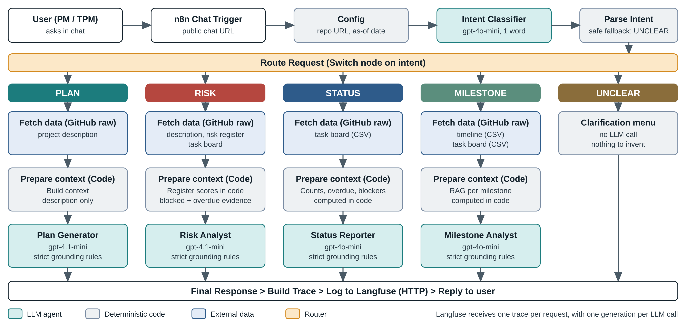

# Mira - Architecture Writeup

## 1. Problem summary

Mira is built for PMs and TPMs who run three to five projects at once and lose hours to creating plans from scratch (3-4 hours each), compiling weekly status reports (1-2 hours), and writing inconsistent risk assessments. It automates four jobs: project plans, risk assessments, status reports and milestone checks, using project description, timeline, task board and risk register files. The biggest risk is fabrication: inventing milestones that are not in the description or task statuses that are not on the board, which would mislead stakeholders.

## 2. Architecture

Flow: Chat Trigger > Config > Intent Classifier > Parse Intent > Route Request (Switch) > one of four lanes (or a clarification menu) > Final Response > Langfuse trace > reply.

## 3. Tool selection

| Category | Choice | Why |
|---|---|---|
| Workflow platform | n8n | Used in class. Visual router (Switch node), Code nodes for deterministic logic, HTTP node for file access, native LangChain agent nodes. |
| LLMs | gpt-4o-mini (classifier, status, milestone), gpt-4.1-mini (plan, risk) | Small models are enough when facts are prepared by code. Plan and risk need longer structured writing, so they use the stronger mini model. Different agents use different models to control cost. |
| Data and APIs | GitHub raw URLs for text and CSV files | Matches the Mira inputs (text and CSV). No OAuth needed. Files are versioned with the project. Trello is an optional extension. |
| Observability | Langfuse (HTTP ingestion from a Code + HTTP node) | Gives input and output per LLM call, token usage, cost and latency. n8n has no built-in Langfuse node, so the workflow posts one trace and one generation per call. |

## 4. Orchestration pattern: Router / Dispatcher

I chose the router pattern because Mira requests are different in kind. A plan request needs only the project description. A status request needs only the task board. A milestone request needs the timeline plus the task board. Each needs different data, a different output format and different guardrails, so each gets its own specialist agent.

Why not the other patterns:
- **Sequential pipeline:** it fits when every input takes the same steps. Mira inputs do not.
- **Hierarchical:** it fits one request that needs several agents. The Mira capabilities are mostly independent, so the added complexity is not justified. It is listed as a next step for combined "weekly review" requests.

A fallback route handles unclear requests with a fixed menu and no LLM call.

## 5. Agents

| Agent | Single job | Input | Output | Key guardrail |
|---|---|---|---|---|
| Intent Classifier (gpt-4o-mini) | Label the request | User message | One word: PLAN, RISK, STATUS, MILESTONE, UNCLEAR | If in doubt, UNCLEAR. Parse Intent code also falls back to UNCLEAR. |
| Plan Generator (gpt-4.1-mini) | Build a plan from the description | Description text | 8-section Markdown plan with a source column | Use only the description. Missing detail = NOT SPECIFIED IN DESCRIPTION. |
| Risk Analyst (gpt-4.1-mini) | Build a risk matrix | Description, register (scores computed by code), task board evidence | Risk matrix, new risks, top 3 actions | Every risk needs named evidence. No generic risks. Register values copied unchanged. |
| Status Reporter (gpt-4o-mini) | Write the weekly report | Facts computed by code | Status report in fixed sections | Copy numbers exactly. Missing data = UNKNOWN or NOT AVAILABLE IN THE DATA. |
| Milestone Analyst (gpt-4o-mini) | Explain milestone health | RAG per milestone computed by code | At-risk table, go-live outlook, actions | Cannot change RAG. No predicted dates. Unknown milestone = NOT IN THE PROJECT DATA. |
| Clarification menu (no LLM) | Ask what the user needs | - | Fixed text with four options | Nothing to invent. |

**Three layers of hallucination control:** (1) prompt rules that say what to do when data is missing; (2) code that computes counts, overdue days, scores and RAG, so the LLM never does arithmetic; (3) a clarification route for vague input.

**Milestone RAG rules (code):** COMPLETE if all tasks are Done. RED if the date has passed, any task is overdue, or a task is blocked and the milestone is due within 30 days. AMBER if a task is blocked, the milestone is due within 30 days with under 60% of tasks done, or it depends on a RED milestone. Otherwise GREEN. No linked tasks = UNKNOWN.

## 6. Cost analysis

Estimates use actual prompt and context sizes from the sample data (characters / 4 as the token estimate) and assumed output lengths. Prices used: gpt-4o-mini USD 0.15 input and 0.60 output per 1M tokens; gpt-4.1-mini USD 0.40 input and 1.60 output per 1M tokens. Check current prices before you submit, and replace these estimates with the real numbers from Langfuse.

| Request type | Tokens in | Tokens out | Cost per run (incl. classifier) |
|---|---|---|---|
| Status | ~1,260 | ~800 | USD 0.00067 |
| Milestone | ~1,260 | ~700 | USD 0.00061 |
| Risk | ~2,080 | ~1,300 | USD 0.00284 |
| Plan | ~1,480 | ~1,300 | USD 0.00260 |
| Unclear (classifier only) | ~280 | ~3 | USD 0.00004 |

Assumed daily use for one PM: 16 requests (8 status, 4 milestone, 2 risk, 1 plan, 1 unclear).

| Item | Estimate |
|---|---|
| Cost per user per day | about USD 0.016 |
| Cost per user per month (22 working days) | about USD 0.36 |
| Data access (GitHub raw) | Free |
| Langfuse | Free tier is enough for evaluation |
| n8n | Existing instance or free self-host |

Comparison: the manual work Mira replaces is 3-4 hours per plan and 1-2 hours per weekly report.

## 7. Production metrics

| Metric | Type | How to measure | Target |
|---|---|---|---|
| **Plan groundedness** | Accuracy / trust | % of milestones and dates in generated plans that appear in the description. Check by hand on a sample of 20 plans. | 100% |
| **Status accuracy** | Accuracy | % of task counts in status reports that match the task board. Automated: compare report numbers to a CSV count (done in test T05). | 100% |
| **Risk relevance** | Trust | % of listed risks that cite concrete project evidence (task ID, dependency, date, register ID) instead of generic text. | 90% or more |
| Routing accuracy | Accuracy | % of requests sent to the correct lane, from a labelled test set. | 95% or more |
| Time saved | Usefulness | Minutes per week on plans and reports before versus after. Short user survey. | 50% less |
| Cost and latency | Operations | Langfuse cost per run and seconds per run. | Under USD 0.01 and under 30 s |

## 8. Testing observations

The 12-case baseline (`tests/baseline_test_dataset.csv`) covers eight normal requests (two per capability) and four edge cases: a vague request (T09), an unknown project (T10), missing data (T11, spend is not in any file), and an unknown milestone (T12).

**Verified before runtime:** the Code nodes were run locally against the sample data. They produced 31 tasks (Done 11, In Progress 3, Blocked 2, To Do 15), 2 overdue tasks (T12, T16), 2 RED milestones (M5, M6), and 4 AMBER milestones downstream of them. The classifier parser falls back to UNCLEAR on unexpected text.

**Add after your run** (from `tests/test_results.md` and Langfuse):
- Number of tests passed: [ ] / 12
- Where the system hallucinated: [ ]
- What you changed in a prompt and the before and after result: [ ] (see `docs/Evaluation_Log.md`)
- Cost per run from Langfuse versus the estimate above: [ ]

## 9. Limitations and next steps

- One intent per message. Next step: a hierarchical "weekly review" agent that calls status, risk and milestone together.
- CSV and text input only. Next step: Trello node for a live board.
- The as-of date is fixed for repeatable tests. For live use, set it to today's date in Config.
- RAG thresholds (30 days, 60%) are team-adjustable rules in the Code node.
